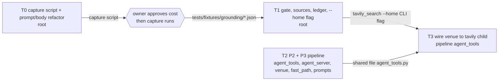

# DESIGN: context-p1-p3 (branch context-engineering)

## Context
- Objective: P1-P3 of `docs/CONTEXT-CRITIQUE.md` section 4. P1 makes grounded answers show a search happened and give a source. P2 fixes D2, D3, D4 and D9. P3 adds a per-turn Now/Place line, a "you cannot" block, and the venue in the grounder prompt.
- Status: plan written, waiting for confirmation (`PLAN.md` beside this file).
- Human-facing doc: `docs/MCP-SERVERS.md` (web_answer). There is no feature doc yet.

## Architecture (data flow; NEW = added by this plan)
```mermaid
flowchart LR
  U[user turn] --> H[AgentServer.handle]
  H -->|"turn it up" after TEMPERATURE/BRIGHTNESS (NEW D9)| G
  H -->|fast path / router| R[router + run_routed]
  H -->|steer + Now/Place line (NEW P3)| G[Gemini front agent<br/>system_agent.txt + D4 rules + cannot block (NEW)]
  H -->|hedged: Now/Place line only (NEW)| G
  G -->|web_research redirect keeps model query (NEW D3)| W
  R -->|web_answer| W
  G -->|web_answer| W[tavily_search MCP child<br/>--home place (NEW)]
  W -->|SYSTEM: OnIt rule + place (NEW)| GG[gemini_grounding.ask]
  GG -->|text, searches, chunks, supports (NEW)| W
  W -->|changeable & searches==0: forced retry, then Tavily, then hedge (NEW)| T[Tavily / hedge]
  W -->|"answer. Source: X." (NEW)| G
  GG -->|row + query, forced, sources (NEW)| L[(web_answer_ledger.jsonl)]
  H -->|end-of-turn only (D2: _recorded touch removed)| C[(chain.json)]
```

## Per-plan task diagram (plan 1)

T0 -> T1 -> T3 is sequential. T2 runs in parallel with T0/T1: there is no edge between them and their files do not overlap. T3 runs last.

## Decisions log
(appended after confirmation)

## Findings index
(appended in Review mode)
