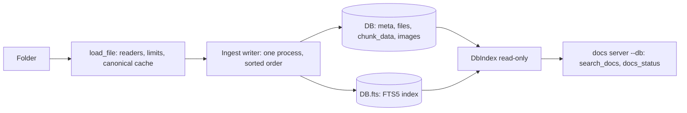

# Standalone ingest and the read-only reader (lean branch, 2026-11-24)

The documents are parsed once by a separate command that writes a database file. The agent's docs server only reads that database, so a restart does not re-read or re-chunk anything, and the heavy parsing can be bounded on its own. Built by tickets 105 to 108 on `lean/me4-pi`.



## Commands
```
python -m voice_agent.rag.ingest SRC --out DB [--workers N] [--worker-mem-mb M] [--file-timeout-s S]
python -m voice_agent.mcp_servers.docs --db DB          # serve it (no polling, no zip ingestion)
```
- Run ingest with the ROOT venv (`.venv`). The pipeline venv lacks some converters: 30 of the 44 test files fail there. `DbIndex` only needs sqlite, so the harness and the agent can read the database from any venv.
- `--workers` defaults to `min(3, cpu_count)`; `0` parses in the writer process. `--worker-mem-mb` sets `RLIMIT_AS` per worker. `--file-timeout-s` (default 300) kills a stuck parser.
- Exit code is 0 even when some files fail: each failure is a row in `files` with its status and error (`unsupported`, `unreadable`, `too_large`, `parser crashed (...)`, `parser timed out`).

## Artifact (two files)
`DB` (sqlite) and `DB.fts` (the `Fts5Retriever` index, same pretok rows as `DocIndex`; ranking is identical). `Fts5Store` deletes a database with extra tables, so they cannot share one file.
| Table (in `DB`) | Content |
|---|---|
| `meta` | `schema_version` (1), `created_at`, `src` (name only), `tokenizer`, `chunker_version`, `complete` (`1` only as the last step) |
| `files` | one row per supported file: `rel_key, status, error, kind, size, mtime_ns, ctime_ns, sha256, canonical_key, note, dates_json, n_chunks` |
| `chunk_data` | every `Chunk` field incl. `converter`, plus `ord` = global order (0..N-1, same as `DocIndex`) |
| `images` | pointer table for OCR (empty today; filled by the OCR stage-A ticket, deferred) |

## Resume rules
- If `meta.complete` is `0` (a crash) or the schema/tokenizer differ, everything is rebuilt.
- If `complete = 1`: `complete` is first set to `0`; files whose size, `mtime_ns` and `ctime_ns` equal the stored row and whose status was `ok` are NOT re-parsed (chunks come from `chunk_data`); changed or new files are parsed; files that disappeared are dropped; `ord` is renumbered; the FTS5 sibling is rebuilt; `complete` returns to `1`.
- Re-running on an unchanged 44-file set reuses all 13,894 chunks in about 1.4 s (warm) instead of re-reading.

## Workers (ticket 108)
Warm worker processes started once; each worker handles one file at a time; the parent dispatches the smallest files first to an idle worker, keeps the results in a reorder buffer and commits strictly in sorted `rel_key` order, so the database is identical for any worker count. A worker that dies, runs out of memory or exceeds the timeout is replaced and its file is recorded as unreadable. Measured on the 160 MB corpus (509 files, 415,972 chunks): 0 workers about 225 s, 3 workers about 127 s (1.8x); the database hash is identical.

## Reader
`DbIndex(db)` opens `DB` read-only, queries the FTS5 sibling for chunk ids in growing windows (64, 512, all) and loads only those rows from `chunk_data`, then applies the same selection as `DocIndex` (`docindex.select_results`: per-file cap, near-duplicate removal, coverage). Verified equal to `DocIndex` on 54 real queries at k = 1, 4, 8 and on the 112-row golden set (94 by tokens / 82 normalised). It raises `DbIndexError` if either file is missing, `complete` is not `1`, or the schema differs.

## Known limits
- The FTS5 build still holds all chunks of one run in memory (about 1.2 GB peak for 416k chunks); at about 2.7M chunks it will not fit the Pi. Fix: build the FTS5 rows from `chunk_data` in batches.
- Text-heavy corpora make a large database (prototype: 4.54 GB for 1 GB of text against 2.4 GB free on the Pi). A disk governor and big-file windows (ticket 110) are deferred.
- Nothing here is measured on the Pi yet.
