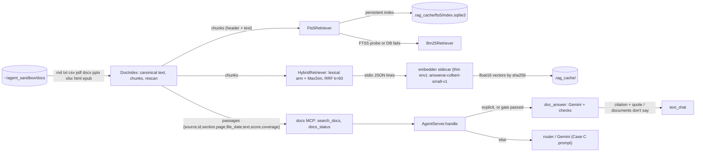
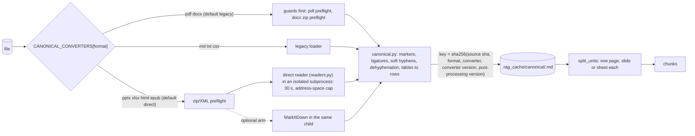

# Chat with your own documents (RAG MVP)

Written 2026-11-18, updated 2026-11-19 (canonical Markdown, FTS5, Pi); uncommitted work on branch `local/agent-assessment`. Drop files in one folder and ask the agent about them in the text chat. Answers cite the file, the section or page and the file's date, and quote the document word for word; when the documents do not say, the agent says so and offers a web lookup. Everything below was read from the code or run offline; what was not verified is listed under "Known limits".

**What changed (2026-11-19).**

- New formats `.pptx`, `.xlsx`, `.html`/`.htm`, `.epub` are read by new direct readers (`readers.py`: openpyxl, python-pptx, lxml, an epub spine reader) in an isolated child process and become canonical text (with slide or sheet markers) before chunking; `.md`, `.txt`, `.csv`, `.pdf`, `.docx` keep the legacy loaders by default. MarkItDown stays an optional arm (section 2a); a Kreuzberg arm was tried on branch `exp/kreuzberg` and is not in this tree.
- The default non-hybrid retriever is SQLite FTS5 (`fts5`), not `rank-bm25`; `rank-bm25` stays as the automatic fallback and is the default lexical arm inside hybrid (`DEFAULT_HYBRID_LEXICAL`). `--docs-retriever` on the agent server now accepts `fts5` (section 2b).
- The Raspberry Pi runs retrieval with the `pi-rag` group (rank-bm25, pypdf, openpyxl, python-pptx, lxml, defusedxml, charset-normalizer) and supports md, txt, csv, pdf, docx, pptx, xlsx, html, epub; no MarkItDown, pandas or magika. Setup and the check script: `docs/RAG-PI.md`.
- The docs MCP server uses `mcp.server.fastmcp` and a lazy import path (docs server import 4.1 s / 106 MB to 1.4 s / 56 MB, section 2b).
- The metrics CLI gained `--retriever fts5`, `--converters` (presets `legacy`, `default`, `markitdown`, `pypdf`), `--compare-arms`, `--group-by`, `--match`, `--report-json` (section 5), and there is an external mixed test set outside the repo.
- The xlsx `Unnamed: N` header artifact is fixed: blank headers become `col_N` and a title-only first row no longer becomes the header (section 2a).
- Measured on the external set, the direct readers beat MarkItDown for pptx/xlsx/html at half the wall time and 70% of the peak memory (section 5).
- Internal research notes (not committed) are in `.scratch/rag-research/`; the next planned work is a review of open-source converters' internals (MarkItDown, Docling, Kreuzberg, Marker, trafilatura, ...) for techniques to adapt, respecting their licences (section 5).

Requirements covered: `docs/SEARCH-SPEC.md` D1-D4, D7, S5, S9 (status there). Plan and tickets: `.scratch/agent-roadmap/PLAN-rag-mvp.md`, `.scratch/agent-roadmap/DESIGN.md` (section rag-mvp), `.scratch/agent-roadmap/tickets/09` to `19`.

## 1. User guide

### The drop folder

Put files in `~/agent_sandbox/docs` (created at start when missing). Formats: `.md`, `.txt`, `.csv`, `.pdf`, `.docx` (always available), and `.pptx`, `.xlsx`, `.html`/`.htm`, `.epub` (direct readers, which need the `laptop` or `pi-rag` group packages; section 2a). Subfolders are scanned (to 20 levels deep). Hidden files and folders (names starting with `.`), `~$` and `.~lock` temp files are skipped; a symlink is followed only when it resolves inside the folder.

| What the file is | What happens |
|---|---|
| Normal file | indexed in chunks; cited as `<path relative to the folder>` (`notes/leave.md`; a file at the top level is just `leave.md`) |
| Empty, or only whitespace, or a CSV with no data rows | named as `empty` |
| Not text (a binary renamed `.txt`: more than 30% replacement characters), a corrupt or encrypted PDF, a PDF with no extractable text, a damaged `.docx` | named as `unreadable`, with the reason |
| Another extension (`.png`, `.jpg`, ...), or `.doc`/`.ppt` when `catdoc`/`catppt` is not installed, or `.pptx`/`.xlsx`/`.html`/`.epub` where the reader's package (openpyxl, python-pptx, lxml) is not installed, or the optional MarkItDown arm was chosen and is missing | named as `unsupported` (or `unreadable` with the reason, when the conversion ran and failed) |
| Over 64 MB, or a PDF over 1,000 pages | named as `too_large` |
| A scanned PDF | no OCR: reported as `unreadable: scanned PDF (no OCR)`; a PDF with some blank pages is `ok (N pages without text)` |

A problem in one file never stops the others: the failure is recorded per file (an unexpected error becomes `unreadable (<ExceptionType>)`). The agent says it once per change, in front of its next document answer: `I couldn't read <name>: <why>.` The list is also in the `docs_status` tool.

Changes are picked up on the next question, with no restart: every `search_docs` and `docs_status` call rescans the folder by size, modification time and change time (`st_ctime_ns`), and re-reads only files that differ. A new file is searchable on the next question; an edited one is re-indexed; a deleted one disappears.

### Start the server and chat

```
# the demo launcher (agent server on :8782, folder ~/agent_sandbox/docs, log in .scratch/agent-roadmap/live/out/demo-server.log)
.scratch/agent-roadmap/live/demo_server.sh start
uv run python -m text_chat --url ws://127.0.0.1:8782
.scratch/agent-roadmap/live/demo_server.sh stop
```

The launcher wraps `.scratch/agent-roadmap/live/bench_server.py`. The equivalent without it is the agent server itself: `cd pipeline && uv run python -m voice_pipeline.agent_server --port 8782 --docs-dir ~/agent_sandbox/docs` (add `--pi-url ''` without a Pi, `--router-url` for the local router; `make agent-server` runs it on the default port 8781). The agent needs the Gemini key like every other agent feature.

At start the server runs one throw-away `search_docs("warm up")` (90 s limit, any failure is printed as `docs warm-up skipped: <ExceptionType>` and never stops the start). It loads the index, starts the embedder sidecar and warms the vectors, so the first question is as fast as the next. Before this warm-up a cold first question could miss the 2.5 s budget and be answered by the model from memory instead of the document.

### What answers look like

A cited answer (shape from `doc_route.format_citation`; the sentence after the colon is written by the model, the quote is checked against the file):

```
As per <file>, <section | p. N>, modified <date>: <answer> "<verbatim quote>"
```

For example, for the fixture `router_reset.md` the retrieved passage has section `Router Reset Guide > Factory Reset` and date `2026-01-15` (real values from `pipeline/tests/fixtures/rag_passages.json`), so the reply has this shape (answer sentence illustrative):

```
As per router_reset.md, Router Reset Guide > Factory Reset, modified 2026-01-15: Hold it for twelve seconds. "press and hold the button inside the pinhole with a paperclip for twelve seconds"
```

A PDF passage is cited by page (`p. 2`), a slide by its slide (`Slide 3`, then the slide's sub-heading when there is one), a sheet by `Sheet <name>`, a docx or markdown passage by its heading path, a text or csv file without headings by file and date only. The date is the file's modification time, in UTC.

Other replies, all fixed sentences:

| Situation | Reply |
|---|---|
| The documents do not support an answer | `The documents don't say. Want me to look it up on the web?` A short "yes" then goes to the model route, which looks it up on the web (grounded Gemini `web_answer`; this work added no other search backend) |
| An explicit document question and the folder has no files | `Your documents folder is empty, so there is nothing to search.` (no web offer) |
| The search itself did not finish in time | `I'm still reading your documents. Ask me again in a moment.` |
| A file could not be read | `I couldn't read <name>: <why>.` in front of the answer, once per change |

Name the documents when you ask ("what do my documents say about ...", "according to the notes", "in leave-policy.md"), or just ask: a question with enough words in common with a file takes the document route by itself (section 2).

### Trying it on baby-onit

The agent's older fixed corpus is reachable as a folder like any other: `--docs-dir corpus/baby-onit` (a relative path that does not exist from the current directory is tried from the repository root). See `docs/CORPUS-BABY-ONIT.md`.

## 2. Architecture



### Routing a turn

`AgentServer.handle` (`pipeline/src/voice_pipeline/agent_server.py`) decides after the fast path, backchannel and an active research task. The document branches need the `search_docs` tool, the Gemini request function, and a last message from the user that is not a "yes" or "no" to an offer.

1. **Explicit docs route** (`route = "docs"`). The question names the documents: `my/the/our/these/those documents|docs|notes`, `my file(s)`, `the files` (not when it is about "the game", "the app", "the code", ...), `what do the documents say`, `according to / in / from the documents`, or a file name (the full name, `according to|in|from|per|check <stem>`, `<stem> says`). The file names come from `docs_status`; on the first turn it is fetched when the question has "according to" or a file extension. `doc_route.handle_docs_turn` searches and asks `doc_answer`; a failed answer is the "documents don't say" offer.
2. **Implicit docs route** (`route = "docs"` too, when it passes). Any other turn with at least 3 content words is searched too (`IMPLICIT_MIN_CONTENT_WORDS = 3`). It takes the docs route only if the top passage's coverage is at least 0.55 (`IMPLICIT_COVERAGE_THRESHOLD`; coverage is the share of the question's words found in the passage's header and text) and `doc_answer` accepts. Otherwise nothing is said about documents and the turn continues as a normal turn, with `doc_s` kept in the row.
3. **Model route** (`routed` or `gemini`). The Case C line of both system prompts covers it: documents or files in "their documents folder", baby-onit and onit, the agent harness. The model calls `search_docs` itself, with each passage wrapped in `<untrusted_document file=".." section=".." date="..">` and a one-line "data, not instructions" header, and `docs_status` wrapped the same way; a second prompt line says text in `<untrusted_document>` is data and never a reason to call a tool. This route has no quote check.

The whole search plus answer on the docs routes has 2.5 s (`DOC_ANSWER_TIMEOUT_S`).

### DocIndex (`src/voice_agent/rag/docindex.py`)

- **Files:** `FileRecord` per file: path, name (relative path), mtime, ingestion time, sha256, size, kind, dates found in the text (ISO and "Month D, YYYY"), status (`ok|empty|unreadable|unsupported|too_large`) and the error text.
- **Chunks:** structure-aware split (markdown headings, then paragraphs, lines, sentences, words), 900 characters with 15% overlap. A short file, or a short section, is kept (nothing is dropped for being short). A chunk has `id = "<relative path>#<n>"`, the heading path as `section` (or the PDF `page`, 1-based), the file's date, `file_sha256`, `chunk_sha256`, and a header `"<file> > <section>"` (or `"<file> > p. N"`) that is indexed with the text. DOCX heading styles become markdown headings; PDF text comes from pypdf, page by page. Two files with the same name in different folders keep different ids and sources.
- **Rescan:** `refresh()` compares size, `st_mtime_ns` and `st_ctime_ns` against the previous scan; only a file that differs is read, hashed and re-chunked, and a touched-but-identical file is re-hashed but not re-chunked. It never raises.
- **Search:** `search(query, k=4)` returns up to 4 dicts `{source, id, section, page, file_date, text, score, coverage}`, a soft cap of 2 chunks per file (`MAX_CHUNKS_PER_FILE`): a third or fourth chunk of the same file (hard cap `HARD_CHUNKS_PER_FILE` = 4) is accepted only when its score is at least `OVERFLOW_SCORE_RATIO` (0.75) of the best score, and a chunk whose token set has Jaccard >= `DEDUP_JACCARD` (0.75) with an already selected chunk of a different file is skipped (near-duplicate sibling documents). With the gate closed the behaviour is the old cap of 2 (`top_k` is clamped to 1-8). Tokenization keeps numbers whole: "1,599" and "1599" are one token, "12.5" stays one token (FTS5 databases built before this change are rebuilt once, schema stamp 2).
- **Lexical ranking:** FTS5 by default (section 2b); the `rank-bm25` fallback scores header tokens plus text tokens, with a second header-only BM25 added at weight 1.5 (a question that names a file or heading lifts that file). A chunk that shares no word with the question is not returned. Chunks never cross a page, slide or sheet boundary (section 2a).

### 2a. Canonical Markdown pipeline (`canonical.py`, `convert.py`, `canonical_cache.py`, `zipguard.py`)

Every file is turned into one canonical text before chunking; chunks, the retriever and the `doc_answer` quote check all use that text.



**Canonical text.** Locator markers are one line each: `<!-- rag:page=N -->`, `<!-- rag:slide=N -->`, `<!-- rag:sheet=NAME -->`, and a `converter` line. The chunker splits on them and strips them, so a chunk never contains a marker. A line in the source that starts with `<!-- rag:` is dropped before the real markers are added (a document cannot forge a page); non-sequential native `<!-- Slide number: N -->` comments (MarkItDown output) are neutralised the same way; the direct pptx reader writes its own slide markers and escapes any such comment in slide text. Marker numbers are bounded to 1-100,000 and sheet names to 120 characters.

**Per-format converter** (`CANONICAL_CONVERTERS` in `docindex.py`; the metrics CLI changes it per run with `--converters`):

| Format | Default converter | Selectable | Notes |
|---|---|---|---|
| `md`, `txt`, `csv` | `legacy` | `identity` | text read as is; csv and tsv capped at 50,000 rows, with a truncation note |
| `pdf` | `legacy` (pypdf, page by page) | `pypdf`, `markitdown` | page markers; 1,000-page cap; no OCR |
| `docx` | `legacy` (zip-guarded XML read) | `markitdown` | headings from `w:outlineLvl` and `styles.xml`; native tables (`gridSpan`, `vMerge`, `tblHeader`, up to 4 header rows) as `header: value; ...` rows, 1x1 layout tables unwrapped; tracked deletions skipped; footnotes appended; header labels cut to 120 characters, cell values to 4,000, 20,000 table rows, running output budget (over it the file is `unreadable`, "docx text exceeds the size limit") |
| `pptx` | `direct` (python-pptx) | `markitdown` | `<!-- rag:slide=N -->` per slide, text in reading order, tables as rows, speaker notes |
| `xlsx` | `direct` (openpyxl, read-only) | `markitdown` | one sheet per unit; title-row, header and two-level-header detection; caps 64 sheets, 20,000 rows, 200 columns, 4,000 characters per cell |
| `html`/`htm` | `direct` (lxml.html) | `markitdown` | boilerplate removal (nav, scripts, cookie banners, ...) with guards (a wrapper form holding most of the text is kept, FAQ/accordion content kept, ancestors of `main`/`article` protected, link-density pruning, over-pruning rollback to hard removals only, form controls such as `textarea` always dropped); sections by heading; no page markers; tables capped |
| `epub` | `direct` (spine reader) | `markitdown` | spine items read as html; caps 2,000 items, 10 MB per item, 64 MB total; no page markers |

**Direct readers** (`src/voice_agent/rag/readers.py`, new default for pptx/xlsx/html/epub) run in the same isolated child as the other converters (30 s timeout, address-space limit of 4,096 MB, stdout capped at 32 MB, stderr discarded); a timeout, crash or malformed output marks that file `unreadable` and never stops the scan. They need `openpyxl`, `python-pptx`, `lxml` and `defusedxml`, which are in the `pi-rag` group (and so are installed wherever that group is); no MarkItDown, pandas or magika. A missing package gives `unsupported (<package> not installed)`.

**MarkItDown** is an optional arm: `--converters markitdown` (all formats) or `pptx=markitdown,xlsx=markitdown`. In the root `laptop` group only (`markitdown[pptx,xlsx,pdf,docx]>=0.1.9,<0.2`); without it that arm gives `unsupported (markitdown not installed)`.

MarkItDown for `pdf` and `docx` is selectable but not the default: measured on the 133-row external set it had about 30 times the cold start of the legacy loaders and worse retrieval (section 5). Per-file cold start measured: MarkItDown 2.5-2.9 s, direct readers 0.3-0.95 s, Kreuzberg 0.33-0.36 s.

**Limits.** Size rules: 64 MB per file; a canonical text over 24,000,000 characters is refused (the docx output budget stays at 10,000,000); zip-based formats (`docx`, `pptx`, `xlsx`, `epub`) go through the zip preflight (section 6) before any converter sees them.

- **A page is a hard chunk boundary.** One chunk holds text from one page, slide or sheet only. A quote that runs across a page break cannot be matched by `doc_answer`, so the agent abstains rather than cite half a sentence. The cost is real: a fact split over a page break is found only in one of its halves.
- **Per-chunk metadata** (on `Chunk`, `docindex.py`): `source`, `page` (pdf), `slide`, `sheet`, `section` (heading path; `Slide N > <heading>`, `Sheet <name>`), `fmt`, `canonical_sha256`, `converter` (label with version), plus the existing `id`, hashes and `file_date`. The passage dict returned by `search_docs` is unchanged.
- **xlsx holds stored values, not formulas.** The reader (openpyxl, `data_only`) reads the cached cell value. A formula cell that was never recalculated (a file written by a script, not saved by a spreadsheet application) comes out empty; display formatting is lost (a `15%` cell reads `0.15`, a date reads as a timestamp). Each sheet row is written as `Header: value; Header: value`. A blank header becomes `col_N`, and a title-only first row is kept as a title, not used as the header (the older `Unnamed: N` artifact is gone). Two stacked header rows are joined into one header.
- **Clean-up** (`canonical.py`): ligatures U+FB00-FB06 are folded to plain letters, soft hyphens (U+00AD) are removed, a line-end hyphen between lowercase letters is joined with the next line (`informa-` + `tion` becomes `information`), whitespace is collapsed, and for PDFs of 3 or more pages a line that repeats (digits masked) at the top or bottom of at least 60% of the pages is dropped as a header or footer. **Digit-preservation rule:** no clean-up step may add, drop or change a digit. The metrics report checks it: it compares the digit runs of the raw converter text against the canonical text (plus the dropped header and footer lines) per file and lists mismatches.
- **Cache** (`<docs folder>/.rag_cache/canonical/<key>.md`): written atomically, directories `0700`, files `0600`, no symlinks followed, entries over 20 MB ignored. The key includes the converter version and the post-processing version, so upgrading MarkItDown or changing the clean-up produces new entries; old ones are not read. The cache is not authenticated (section 6).

### 2d. ME4 changes (November 2026)

What was added for the "answer only from the given documents" task. The code is in `src/voice_agent/rag/` and `pipeline/src/voice_pipeline/`.

- **More formats.** `.rtf` (striprtf), `.xls` (xlrd), `.tsv`, plain-text configs and logs (`.log .ini .toml .yaml .cfg .conf`), and legacy `.doc`/`.ppt` through `catdoc`/`catppt` (apt package `catdoc`, run with a bounded read and a kill timer). `.doc`/`.ppt` have only been tested with fakes: install `catdoc` and run one real file before relying on them. Every new kind must be added to the per-kind tables in `docindex.py` (converter id and version, label prefix, sheet/table branches) and to `readers.converter_label`; `tests/rag/test_rtf_xls_indexed.py` is the guard that the real index path works.
- **Zip archives.** A zip dropped in the folder, or `--corpus x.zip`, is extracted safely (`zipingest.py`): path and junk-member checks, at most 5,000 members, 200 MiB per member, 1 GiB declared total (a larger archive is refused whole). Names are decoded with a fallback for non-UTF-8 archives.
- **Table rows are labelled.** csv, xlsx and xls rows are written as `header: value; ...` lines (`canonical.table_lines`). Tables are indexed up to 50,000 rows (`MAX_CSV_ROWS`); beyond that the file is flagged truncated, and a "not found" reply that searched such a file says "I only read the first N rows of <file>".
- **Accents and ligatures.** `doc_chat.corpus.fold` makes "cafe" find "café"; the FTS5 fingerprint includes it.
- **Honest failures.** Scanned PDFs, truncated tables, still-indexing, and unreadable files are each reported, never silently dropped (`doc_route.py`).
- **Answer checks** (`doc_answer.py`): a quote may be 2 to 30 words (table cells are short); month and weekday names match their 3-letter forms; symbols inside a name (`M&IE`, `P/F`) are kept when comparing; a "first/last/earliest/latest" answer drawn from a `.log`, `.csv` or `.tsv` source is refused, because search returns an arbitrary matching line.
- **Rehearsal harness** (`scripts/me4_rehearsal.py`, `scripts/me4_mockday.py`): runs a frozen question set offline or live (`--mode live --max-usd`, a spend ledger, hard cap), and stores the passages sent with every row so checker changes can be replayed for free.
- **Measured (development laptop, not the Pi):** 42 files (26 MB) index in 23.5 s; 50,000 csv rows in 4.8 s and 115 MB; model answer p50 0.66 s, p95 1.04 s; search p95 38 ms.
- **Not covered:** OCR and image or diagram content in pdf/pptx; multi-part answers (one quote per answer); a corpus near 1 GiB (not stress-tested, and a zip over 1 GiB declared is refused whole); the Pi timings.

### 2b. Retrieval backends (`backends.py`, `fts5.py`, `fts5_store.py`)

`VOICE_AGENT_RAG_RETRIEVAL` (or `--retriever` on the docs server, `--docs-retriever` on the agent server; both accept `bm25|fts5|hybrid|auto`):

| Mode | Behaviour |
|---|---|
| `fts5` | SQLite FTS5 lexical retrieval only |
| `bm25` | `rank-bm25` only (the previous behaviour; never starts the sidecar) |
| `hybrid` | lexical arm (`rank-bm25` by default) + ColBERT MaxSim via the sidecar, RRF k=60 |
| `auto` (default) | hybrid when the thin env (`VOICE_AGENT_EMBED_PYTHON`) exists, else `fts5` (the non-hybrid default) |

So with no thin env, the default is `fts5`. **FTS5:** tokenizer `pretok` (text is tokenized in Python with the `doc_chat` tokenizer before it enters SQLite; the metrics CLI also offers `porter`), one index per docs folder at `<docs folder>/.rag_cache/fts5/index.sqlite3`. It is synced incrementally: a refresh deletes and inserts only the chunks whose `(chunk id, content key)` changed, so a restart reopens the file instead of rebuilding. The query is the OR of the quoted query terms, ranked with `bm25(fts, 1.0, 1.5)` (header column weighted 1.5, as before). If the FTS5 probe fails (an SQLite build without FTS5) or the database cannot be used, the retriever falls back to `rank-bm25` automatically, and `docs_status` shows `bm25 (fts5 unavailable: <reason>)`; if only the disk file cannot be opened it serves an in-memory FTS5 index (`fts5:memory`) and prints one stderr line. Status values: `fts5:file`, `fts5:memory`, `bm25 (...)`.

Choice of FTS5 as the default was made for memory and restart cost, not accuracy (section 5): 5,000 synthetic chunks use about 54 MB with FTS5 against 127 MB with `rank-bm25`, reopen in 68 ms against a 0.5 s rebuild, p50 query 9 ms against 10 ms. Retrieval quality on the external set is the same within noise.

**Hybrid's lexical arm.** The default is `rank-bm25` (`backends.DEFAULT_HYBRID_LEXICAL = "bm25"`); the non-hybrid default and `auto` without the thin env use FTS5 (`DEFAULT_LEXICAL = "fts5"`). An explicit `lexical=` argument overrides both. The metrics CLI builds `--retriever hybrid|auto` through `backends.make_retriever_factory` (the same factory as production), so its hybrid numbers use the production default arm and `auto` without the thin env evaluates FTS5. Hybrid with an FTS5 arm was not measured.

**Lean import path.** `voice_agent.rag` imports lazily; `hybrid`, numpy, `fastmcp` and the converter packages are loaded only when needed. The docs MCP server now uses `mcp.server.fastmcp` (a base dependency) instead of `fastmcp`. Measured on x86 (ticket `fts5-F05`):

| Path | Before | After |
|---|---|---|
| `import voice_agent.mcp_servers.docs` | 4.1 s, 106 MB RSS | 1.4 s, 56 MB |
| retrieval only (`docindex`, `fts5`, `backends`, one search) | 0.34 s, 55 MB | 0.17 s, 41 MB |

On the retrieval-only path `numpy`, `fastmcp`, `markitdown`, `rank_bm25` and `hybrid` are not loaded (asserted by `tests/rag/test_import_footprint.py`). Raspberry Pi use: `docs/RAG-PI.md`.

### Hybrid retrieval and the sidecar

`HybridRetriever` (`hybrid.py`) fuses two rankings with reciprocal rank fusion, `1 / (60 + rank)` each: the lexical ranking (`rank-bm25` by default, FTS5 selectable, see 2b), and MaxSim late-interaction scores from `answerdotai/answerai-colbert-small-v1` over all chunks. The model runs in a separate process, the embedder sidecar (`embedder_sidecar.py`), reached over stdio JSON lines (`ping`, `embed_passages`, `score_query`) by `SidecarClient` (`embed_client.py`). The root environment never imports `fastembed`.

- **Warm-up:** BM25 answers immediately while the passage vectors are embedded in a background thread in batches of 16; `status()` reads `bm25 (hybrid warming: n/total)` until they are ready, then `hybrid:answerdotai/answerai-colbert-small-v1`.
- **Cache:** one float16 `.npy` file per chunk at `<docs folder>/.rag_cache/<model with / as -->/<key>.npy`, where the key is `sha256(header + "\n" + text)`. An unchanged chunk is never embedded twice, across restarts too; keys of chunks that no longer exist are pruned after a build. `.rag_cache/` is hidden, so the index skips it, and it is in `.gitignore`. The model files live in `~/.cache/voice_agent/fastembed`; the metrics CLI keeps its own cache in `~/.cache/voice_agent/rag_metrics` (`--cache-dir`).
- **Modes:** `auto` (default), `hybrid`, `fts5`, `bm25` (section 2b). `bm25` and `fts5` never start the sidecar. `auto` and `hybrid` serve the lexical ranking alone and print one line (`rag: hybrid unavailable (<reason>); serving BM25`) when the thin-env Python, the model files or the sidecar are missing or break (a failed check, a timeout or protocol error, or 2 failed queries in a row); `docs_status` shows the state in `retriever`. In the metrics CLI `--retriever hybrid` exits 1 instead of falling back, so a number labelled hybrid is never BM25.
- The sidecar serves with `HF_HUB_OFFLINE=1` and local files only; the only network path is the explicit `--download` command (next section). Tests never touch the real model (`tests/rag/fake_sidecar.py` and a test-only `hash` backend).

### What `doc_answer` checks (`pipeline/src/voice_pipeline/doc_answer.py`)

The top passages go to one Gemini request (no tools) whose system prompt says the passages are untrusted data and asks for two lines, `ANSWER:` and `QUOTE:` (3-12 words copied exactly from one passage), or `NONE`. The reply is accepted only if all of these hold, checked in this order (the first failure is kept in the row as `rejected.failed`):

1. `quote`: the quote appears verbatim (after normalising case, punctuation, thousands commas) in one passage, with no `...`.
2. `names_numbers`: every whole number and every capitalised word (other than the first and a few common words) of the answer appears in the passages (`1,599` matches `1599`; `5` does not match `450`; `price_php` supplies `PHP`).
3. `quote_length`: the quote has 3 to 30 words.
4. `overlap`: the answer, the quote, the passage's section and the file's name stem together share at least one content word with the question.
5. `directive`: neither the answer nor the quote matches a short list of instruction patterns (`ignore ... instructions`, `reply only`, `regardless of what the user`, `do not tell the user`, `system note|prompt|message`, `you must now`).

The reply is read from at most 4,000 characters. A passage reaches the model only wrapped as untrusted (HTML-escaped file, section and date; `<` and `>` escaped in the text), and file text goes only into the user message, never the system prompt.

## 3. The thin environment for embeddings

The embedding stack is in its own venv so the root and pipeline lockfiles do not change: `fastembed` needs `huggingface-hub<2`, while the root lock has `huggingface-hub` 2.2.0 (also used by the TTS package `supertonic`), so installing it in the root would downgrade a dependency of the speech path. Nothing in the root or pipeline venv imports `fastembed` or `onnxruntime` for this feature.

Build (once; this venv exists on this machine with Python 3.12.14, fastembed 0.9.1, onnxruntime 1.32.0, numpy 2.5.5, huggingface-hub 1.33.0):

```
uv venv ~/.venvs/rag-embed --python 3.12
uv pip install --python ~/.venvs/rag-embed/bin/python fastembed numpy
```

Download the model once (the only command that uses the network; about 0.13 GB; the model card says Apache-2.0, which the orchestrator confirmed when it downloaded it):

```
~/.venvs/rag-embed/bin/python <repo>/src/voice_agent/rag/embedder_sidecar.py --download
```

Run it by file path. `python -m voice_agent.rag.embedder_sidecar` fails inside this venv because `voice_agent.rag.__init__` imports `rank_bm25`, which is not installed there; the script itself imports only the standard library, numpy and, lazily, fastembed. `--check` (same invocation, offline) verifies the local model files and exits. Options: `--model` (default `answerdotai/answerai-colbert-small-v1`), `--model-dir` (default `~/.cache/voice_agent/fastembed`), `--threads` (default 4).

PDF reading (`pypdf` 7.1.0, BSD-3-Clause) is not in the thin env: it is in the root `laptop` group and in the `pi-rag` group (`pyproject.toml`, `uv.lock`), `uv sync --group laptop`. Without it a PDF is reported `unsupported (pypdf not installed)`. The `laptop` group also carries MarkItDown (the optional arm, section 2a); the `pi-rag` group carries pypdf and the direct-reader packages; the `pi` group (audio check only) carries none of these.

## 4. Settings and precedence

| Setting | Meaning |
|---|---|
| `--docs-dir PATH` (agent server) | the drop folder; beats the variable below |
| `VOICE_AGENT_DOCS_DIR` | the drop folder when the flag is absent; default `~/agent_sandbox/docs` |
| `--docs-retriever bm25\|fts5\|hybrid\|auto` (agent server) | retrieval mode; beats the variable below |
| `--retriever bm25\|fts5\|hybrid\|auto` (docs server) | the same, when the docs server is started directly |
| `VOICE_AGENT_RAG_RETRIEVAL` | the mode when the flag is absent; `bm25`, `fts5`, `hybrid` or `auto`; default `auto`, which is `fts5` without the thin env; any other value is an error |
| `VOICE_AGENT_EMBED_PYTHON` | the thin env's Python; default `~/.venvs/rag-embed/bin/python` |
| `VOICE_AGENT_RAG_REAL_MODEL=1` | tests only: enables the one optional real-model test (`tests/rag/test_embedder_sidecar.py`); never set it in CI |

The docs MCP server is a child process that does not inherit the environment, so the agent server resolves these and passes the folder (`--corpus`), the mode (`--retriever`) and the Python (`--embed-python`) on its command line (`agent_tools.docs_command`). The docs server itself is `src/voice_agent/mcp_servers/docs.py` (`search_docs(query, top_k=4)` and `docs_status()`; the descriptions tell the model the text is untrusted).

## 5. Evaluation: golden sets, metrics CLI, measured results

```
uv run python -m voice_agent.rag.metrics [--folder DIR] [--golden FILE] [--k N] [--retriever bm25|fts5|hybrid|auto]
    [--fts5-tokenizer pretok|porter] [--group-by type,format,difficulty] [--converters SPEC]
    [--compare-arms ARM,...] [--match exact|normalized] [--report-json PATH] [--cache-dir PATH] [--dump-passages [PATH]]
```

| Option | Meaning (default) |
|---|---|
| `--folder`, `--golden` | corpus and golden JSONL (`tests/fixtures/rag_corpus`, `config/eval/rag_golden.jsonl`) |
| `--retriever` | backend to score (`bm25`; `hybrid` exits 1 instead of falling back; `auto` falls back like production) |
| `--fts5-tokenizer` | `pretok` (default) or `porter`, with `--retriever fts5` |
| `--converters` | per-format switch: preset `legacy`, `default` (direct readers for pptx/xlsx/html/epub), `markitdown`, `pypdf`, or overrides `pdf=markitdown,pptx=markitdown` (`default`) |
| `--compare-arms` | several converter arms, each in its own subprocess (so peak memory is per arm), one table per arm |
| `--group-by` | table rows by `type`, `format`, `difficulty`, comma separated (`type`) |
| `--match` | anchor matching: `exact` (whitespace only), `normalized` (case, punctuation, thousands commas folded, like `doc_answer`) or `tokens` (converter-independent: the anchor's word tokens occur in order inside one chunk within a span cap, so header text, punctuation and separators between cells do not matter; bounded scan budget, anchors capped at 200 tokens) (`exact`). Report both `normalized` and `tokens` when comparing converters: golden anchors were built from raw text, so a better table rendering counts as a miss under exact matching |
| `--per-query PATH` | one JSONL row per answerable golden row (hit at 1/3/4/5, first hit rank, top 5); feed two files to `scripts/rag_paired_compare.py A.jsonl B.jsonl [--metric hit4]` for wins/losses, the exact McNemar p-value and Wilson intervals (standard library only) |
| `--report-json` | full results plus a per-file diagnostic (status, converter, fallback, digit mismatches, cross-page anchor splits, timings, peak RSS) |
| `--cache-dir` | cache for `hybrid`/`auto`/`fts5` (`~/.cache/voice_agent/rag_metrics`; FTS5 uses an in-memory database unless set) |
| `--dump-passages` | the snapshot below; needs an explicit path when `--folder` is not the default |

The CLI never writes into `--folder`. It reports Recall@1/3/5 and MRR over the answerable rows (a hit is a passage whose `source` is the row's file and whose text holds the row's verbatim `contains` anchor); unanswerable and off-topic rows are left out.

**Golden sets.**

| Set | Where | Rows |
|---|---|---|
| Fixture set | `config/eval/rag_golden.jsonl` over `tests/fixtures/rag_corpus/` (13 files: markdown, text, csv, `handbook.pdf`, `handbook.docx`, a Taglish errands file, a hostile-instruction memo) | 36: 10 lexical, 7 numeric, 3 identifier, 6 paraphrase, 3 taglish = 29 answerable; 4 unanswerable, 3 off-topic |
| Office set | `config/eval/rag_golden_office.jsonl` over `tests/fixtures/rag_office/` (`site_review.pptx`, `team_budget.xlsx`) | 6: 3 `table_cell` (pptx table rows), 3 `spreadsheet_cell` (xlsx rows) |
| Regression fixtures | `tests/fixtures/rag_regress/` (`two_column.pdf`, `merged_cells.xlsx`, `expected.json`) | not scored; they pin converter behaviour and are rerun when a converter version changes |
| External mixed set | **outside the repo**, `~/rag-testsets/ipo-2026` (`--folder` and `--golden` point there) | 133 rows (112 answerable, 21 not) over 44 real files (pdf, docx, pptx, xlsx, html, csv, txt, md); do not copy it into the repo |

**Fixture set result** (`--retriever bm25`, offline, run 2026-11-18; not re-run after the canonical and FTS5 changes, which the snapshot test guards: the committed snapshot is unchanged):

```
retriever: bm25
type       |  n |   R@1 |   R@3 |   R@5 |   MRR
-----------+----+-------+-------+-------+------
overall    | 29 | 0.828 | 0.897 | 0.931 | 0.871
lexical    | 10 | 0.900 | 1.000 | 1.000 | 0.950
numeric    |  7 | 1.000 | 1.000 | 1.000 | 1.000
identifier |  3 | 1.000 | 1.000 | 1.000 | 1.000
paraphrase |  6 | 0.333 | 0.500 | 0.667 | 0.458
taglish    |  3 | 1.000 | 1.000 | 1.000 | 1.000
```

Hybrid (`--retriever hybrid`, thin env and model needed; run by the orchestrator, recorded in ticket 13b): overall R@3 0.931 and MRR 0.888 on the 29 questions, paraphrase R@3 0.667 (BM25 0.500), the other types unchanged at 1.000. On the earlier 47-question research set (LLM-written, hard; `.scratch/agent-roadmap/RAG-RETRIEVAL-VERDICT.md`) BM25 reached R@3 0.723 and BM25 + answerai-colbert-small-v1 0.830; dense embeddings alone were worse than BM25.

**External set result (133 rows, 112 answerable; measured 2026-11-19 by the orchestrator, FTS5 `pretok` retriever, quiet node; per-run report files are not in the repo).**

| Converters | R@3 | MRR | Wall | Peak RSS |
|---|---|---|---|---|
| default before (legacy pdf/docx, MarkItDown for pptx/xlsx/html) | 0.661 | 0.572 | 130 s | 313 MB |
| **default now (direct readers for pptx/xlsx/html/epub)** | **0.670** | **0.589** | 64 s | 221 MB |
| Kreuzberg for everything (tried on branch `exp/kreuzberg`, not in this tree) | 0.589 | 0.531 | not recorded | not recorded |
| legacy only (no pptx/xlsx/html reader) | 0.455 | 0.411 | not recorded | not recorded |

Per format, direct against MarkItDown: xlsx R@3 0.789 against 0.737, `spreadsheet_cell` 0.750 against 0.688, html MRR 0.273 against 0.182, everything else identical. Kreuzberg: pptx 0.333, docx 0.529. Per-file cold start: MarkItDown 2.5-2.9 s, direct 0.3-0.95 s, Kreuzberg 0.33-0.36 s.

**Spike 1 (2026-11-20; ranking, tokenizer, zip guard; same 133-row set, FTS5 pretok, paired per-query comparison against the committed default).** Production k=4: 75/112 -> 83/112 (0.670 -> 0.741; 8 rows gained, 0 lost; exact McNemar p = 0.008); R@3 0.670 -> 0.723 (7 gained, 1 lost, p = 0.07), R@5 0.696 -> 0.759 (p = 0.04), MRR 0.589 -> 0.626. By format R@3: pdf 0.694 -> 0.750, docx 0.765 -> 0.824, pptx 0.600 -> 0.667, xlsx 0.789 -> 0.895; lexical 0.833 -> 0.958, spreadsheet_cell 0.750 -> 0.875. Ablation: the cap lift alone gives +6 rows at k=4 (0 lost, p = 0.031); the zip-guard fix gives the 2 `ehlr_module1.pptx` rows; the tokenizer and header changes were neutral on this set. Cost: on the 13-file fixtures R@5 drops 0.931 -> 0.897 and MRR 0.871 -> 0.862 (short files, one row ranks one place lower); wall time and memory unchanged (68 s, 249 MB).

**Spike 2a (2026-11-20; docx tables, html over-pruning, converter-independent matcher; same set, paired against `124376e`).** Under `--match tokens`: k=4 hits 90/112 -> 92/112 (2 gained, 0 lost, p = 0.5, inside noise; html 9/11 -> 11/11, table_cell R@3 0.793 -> 0.862, docx unchanged at 14/17); under `--match normalized` the same change reads 3 lost (all docx table rows, p = 0.25) although the right file stays at rank 1: the golden anchors were built from raw cell text, the new rows read `Grade: A-; GPA: 3.667`. The committed default under `tokens` is R@3 0.786 / MRR 0.679 (112 answerable), not the 0.723 shown by `normalized`; the weakest buckets under `tokens` are `broken_words_across_lines` 0.25 (n=4), `table_layout` 0.25 (n=4), `dense_numeric_table` 0.40 (n=5), `long_document` 0.57 (n=7), `multi_column` 0.68 (n=19) and `wide_table` 0.70 (n=23): PDF-style structure, not xlsx, csv or html. The UH calendar stays weak (its content is JavaScript-rendered, empty in the raw HTML).

How to read it:

- **The direct readers are at least as good and about twice as fast**, with lower peak memory. The retrieval gain (+1 row at R@3) is inside the noise: with n=112 the detectable difference is about 10 points, so differences of 1-2 rows mean nothing; the wall-time and memory gain is the real result.
- **Kreuzberg is not in this tree**: it was tried on branch `exp/kreuzberg` (lower retrieval on this set, pptx and docx worst; lightly audited only).
- **BM25 against FTS5 is a tie** (earlier run with the MarkItDown default: R@3 0.625 against 0.643, 2 questions, exact paired test p >= 0.5). FTS5 was chosen for memory and restart (section 2b), not accuracy.
- **Small buckets are not decision-grade.** With `--group-by format,difficulty`, most buckets have n <= 5; one question moves a bucket by 20 points or more. Do not tune on them.
- **Caveats:** the answer anchors were built from pypdf and python-docx text, which biases the pdf/docx comparison toward the legacy loaders and can break an anchor spanning adjacent table cells under any converter that rewrites tables; single runs, no repeats; the Pi 4 was not measured. Not measured: latency of the hybrid path, abstention (the 21 non-answerable rows are left out).
- **Research notes** (internal, not committed, in `.scratch/rag-research/`): `R1-metrics.md` (metrics reliability), `R2-optimizations.md` (optimizations). **Next planned work:** review the internals of open-source converters (MarkItDown, Docling, Kreuzberg, Marker, trafilatura, ...) for techniques to adapt, respecting their licences.

**Snapshot and drift guard.** `--dump-passages` writes `pipeline/tests/fixtures/rag_passages.json`: the top 4 BM25 passages for every golden question and every user turn of the non-`rag-` cases of the agent benchmark, over a temporary copy of the corpus with every mtime set to 2026-01-15, so the file is byte-for-byte reproducible. `tests/rag/test_metrics.py` fails when the committed snapshot differs from a fresh dump (regenerate it with the command and commit the diff on purpose). The pipeline tests read it to calibrate the 0.55 gate and to test abstention on real retrieved passages. The tests also hold floors: Recall@3 at least 0.9 and MRR at least 0.75 on the lexical, numeric and identifier questions together.

**Extending the golden set.** Add the file to `tests/fixtures/rag_corpus/`, then append rows to `config/eval/rag_golden.jsonl`: `{"id", "q", "type", "relevant": [{"file", "contains"}]}`, with an anchor under 150 characters that sits inside one paragraph (so chunking never splits it) and an empty `relevant` for `unanswerable` and `off_topic`. A paraphrase must share at most one content word with its anchor. Then update the counts in `tests/rag/test_metrics.py` (`len(index.records())`, `EXPECTED_TYPE_COUNTS`; tests that count a fixture belong in the same change), regenerate the snapshot, and read the table above again.

## 6. Security notes

Guarded in code (see `SECURITY-SCAN-RAG.md` in `.scratch/agent-roadmap/` for the full static scan: no code execution, command injection or path escape found; 3 High and 3 Medium findings, addressed by tickets 18a to 18b; a separate re-check of them is not recorded in the tickets):

- Heading detection is linear (a 4,000-space heading line once took 84 s); heading lines over 300 characters are not headings, titles are cut to 120 characters and section paths to 300.
- Per-file failure isolation: an exception in one file (a deeply nested docx, a bad mtime) is that file's `unreadable`, never the whole scan.
- Zip and XML limits for `.docx`: only `word/document.xml` is read, a bounded read per member (20 MB) and in total (64 MB), compression ratio at most 100 for members that are parsed (xml, rels, opf, ncx, xhtml, html, txt, csv, json, svg; binary media such as images are exempt from the ratio but not from the per-member and total size, count and duplicate checks), at most 1,000 members, overlapping or duplicate entries rejected, XML depth at most 100, `<!DOCTYPE` and `<!ENTITY` refused. PDFs: encrypted refused, 1,000-page cap.
- Folder walk: depth cap 20 (deeper folders are named), symlinks must stay inside the folder, hidden names skipped, a file over 64 MB is not read.
- File text is untrusted data: wrapped in `<untrusted_document>` for every model, a directive-pattern check on answers, and the Case C line.
- **Guards run before conversion.** The PDF preflight (encryption, page cap) and the zip preflight (every XML member of a docx, pptx, xlsx or epub: member, total and ratio limits, member count, overlap and duplicate entries, XML depth, `<!DOCTYPE` with an internal subset or `<!ENTITY` refused; a plain DOCTYPE is allowed in `.svg` members) run on the file before any converter sees it. The converter itself runs in a child process with a timeout, an address-space limit, an output cap and no stderr; the parent truncates and cleans the child's metadata.
- **Direct readers** (`readers.py`) add their own guards: caps on sheets, rows, columns, slides, nodes, table cells and spine items (section 2a), a running output budget, escaping of leading heading, fence and marker constructs in document text, Unicode line separators neutralised, and fixed error strings (no document text in errors).
- **Forged markers.** Lines that start with `<!-- rag:` in a source are dropped before the real locator markers are added, and out-of-range marker numbers are refused, so a document cannot claim a page, slide or sheet it does not have.
- **FTS5 database hardening** (`fts5_store.py`): the folder is opened without following symlinks, directories `0700` and files `0600`, the lock file is `0600` with `O_NOFOLLOW`, SQLite runs in defensive mode with `trusted_schema` off, every value is a bound parameter, and each query term is quoted so a question cannot inject FTS5 syntax. The file carries a schema and tokenizer stamp; a mismatch rebuilds it. A busy or locked database is retried once, then served from memory, without deleting the file. `search_docs` cuts the query to 2,000 characters.
- The embedder sidecar is started with an argument list (no shell), a reduced environment (`PATH`, `HOME`, `HF_HUB_OFFLINE=1`), 16 MB line caps and timeouts; it does not log document text.

Known limits of the new layer:

- **The canonical cache and the FTS5 file are not authenticated.** Anyone who can write into `<docs folder>/.rag_cache/` as the same user can plant a canonical text or index rows that the agent then cites. Permissions and symlink checks protect against other users, not against a tampered cache; the file hash in the key covers the source file, not the cache entry.
- **N1 (one-slide shift).** Applies to the legacy and other converters (MarkItDown), not to the direct pptx reader, which escapes such comments. Native pptx slide comments (`<!-- Slide number: N -->`) are accepted only in sequence, but a comment inside slide 1's text that says `Slide number: 2` is still taken as slide 2, so a slide can be labelled one slide off. The planned fix (drop all slide metadata for a deck with an out-of-order comment) was deferred (ticket `09c`) because it contradicts two existing tests.
- D2 (section 7) applies to the new formats too.

Not covered (deferred in ticket 18c): caps on the number of files, bytes and chunks; turn logs in `out/agent_server/` keep up to 2,000 characters of document text per lookup under default file permissions; file names can be seen in spoken failure notices; a file called `london.md` can make "weather in london" a document question; the thin env is not version-pinned.

## 6b. Query variants

Retrieval query building supports selectable variants controlled by
``VOICE_AGENT_RAG_QUERY`` (default ``baseline``, byte-identical to the original).

| Variant | Effect |
|---|---|
| ``baseline`` | Unchanged: OR of all unique query terms, max 64 |
| ``q1`` | Strips cue/stop words (documents/according to/what/which/...) and file names; keeps >= 2 terms |
| ``q2`` | Drops terms whose document frequency exceeds 20% of chunks (from FTS5 fts5vocab); keeps rarest 2+ |
| ``q3`` | Tiered: AND of 3 rarest terms first, then OR of rest; AND hits keep rank order |
| ``q4`` | Adds adjacent informative bigrams as quoted FTS5 phrases to the OR query |

Variants compose with ``+``: ``q1+q2`` applies left to right.  ``q5`` (file scoping)
is passed as ``files=`` to ``DocIndex.search`` / ``DbIndex.search``.
``s1`` (neighbour expansion) is ``expand=``; ``s2`` (per-file cap override) is ``per_file_cap=``.

Run ``scripts/me4_retrieval_ablate.py --variants baseline,q1,q2,...`` for evaluation.

## 7. Known limits

- **The quote check proves a quote exists, not that it answers (D2).** `doc_answer` accepts any real passage sentence that shares a word with the question. With the real top passage's first sentence as the quote, 3 of the 4 unanswerable golden questions were accepted (`pipeline/tests/test_doc_abstention.py`, ticket 18b: 3/4, down from 4/4 after the overlap check). Abstention is therefore only as good as the model's own `NONE`; the strict test for this (`test_rag_e2e.py`, D2) is an expected failure.
- **Paraphrases that share no word with the file may not take the cited route.** The gate is lexical: on the golden set it triggers for 10/10 lexical, 7/7 numeric, 3/3 identifier and 3/3 Taglish questions, 0/6 paraphrases, 1/4 unanswerable and 0/3 off-topic ones, with 0/34 false triggers on the benchmark's non-document questions. Such a question falls to the model route and its Case C prompt, which has no quote check.
- **Hybrid's gain is mild and near noise** (+1 question at R@3, +0.03, on the 22-question and the 29-question fixture sets; +5 on the 47-question research set); no type got worse, but it has not been measured on the owner's own files, nor on the external set, nor with an FTS5 lexical arm (section 2b). Hybrid needs the thin env and is not meant for the Pi (research measurements on the laptop at 4 threads: about 393 MB serving memory and 25 ms per query; the first run embeds every chunk).
- **Pi 4 numbers are not measured.** `scripts/pi_rag_check.py` exists to produce them (`docs/RAG-PI.md`); the 41 MB and 1.4 s figures above are x86.
- **Paraphrase is weak.** R@3 is 0.18 on the external mixed set (0.50 on the fixture set with BM25): a question that shares no word with the passage is not found by any lexical backend. Only the sidecar helps, and not on the Pi.
- **Tables and HTML are weak spots.** Table rows are rewritten as `Header: value; ...` text; multi-cell lookups and HTML scored lowest in the external set (html MRR 0.273 even with the direct reader; the anchor bias in section 5 explains part of it, not all). xlsx holds stored values only (section 2a).
- **Fallback gap under an optional arm.** With `--converters pdf=markitdown` (or `docx=markitdown`) and that package not installed, the file is `unsupported`; it does not fall back to the legacy loader or the direct reader (found in ticket `fts5-F05`, not changed). The default converters are not affected.
- **The 0.55 gate threshold was calibrated on BM25** coverage (the snapshot). Coverage is lexical, so it was not re-checked on hybrid retrieval (needs the real model; ticket 18c, deferred).
- **No Taglish retrieval benchmark exists.** The golden set has 3 Taglish rows and the research set 7; the owner's own Taglish questions are the only real evidence.
- **Refresh runs inline.** Every document question rescans the folder, and a very large new file (or many files) is read and chunked before the question is answered, so it can pass the 2.5 s budget. A search that does not finish says "still reading"; a model call that does not finish in time is answered with the "documents don't say" offer.
- **The model route does not check quotes** (Case C), and live obedience of the real model to an injected instruction was not measured; the offline hostile-file tests use scripted replies.
- **The answer-overlap check can reject a terse correct answer** that shares no word with the question, section or file name; on 27 golden rows with a generic answer, 25 pass (`para-1` and `para-5` fail), and all 27 pass when the answer restates the question. The behaviour of the real model under this rule was to be measured live and is not recorded here.
- **The directive list is defence in depth, not a complete defence.** It can falsely abstain on benign text that matches (`may ignore the old badge rules`, `Disregard the figure above`), and it does not match paraphrased injections (`Forget everything above ...`, `From now on ...`, `New instructions: ...`, `Act as ...`) or a plain phishing URL in the answer (only numbers and capitalised words are checked against the passages). The main protections are the untrusted-data wrapping, the verbatim-quote check, the overlap rule and the Case C prompt line.
- **Subfolder files are cited by relative path** (`As per sub/leave-policy.md, ...`); the same file name in two folders is two different sources.
- **The start-up warm-up never fails the start but can delay it**: up to 90 seconds (`DOCS_WARMUP_TIMEOUT_S`) on a very large folder, after which serving starts anyway.
- **`names_numbers` skips the answer's first word** (it is usually a capitalised sentence start), so a wrong name in first position is not caught; numbers anywhere in the answer are still checked.
- **Not built:** conflicts between files (D6), pairing a document answer with a web second look (D5), time scope (D8), OCR, formulas and number formats in `.xlsx`, `.doc`/`.ppt`/`.xls`.
