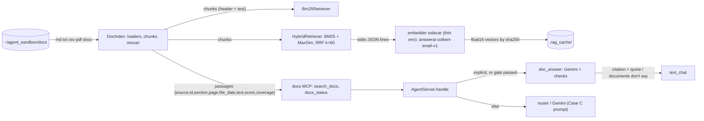

# Chat with your own documents (RAG MVP)

Written 2026-11-18, uncommitted work on branch `local/agent-assessment`. Drop files in one folder and ask the agent about them in the text chat. Answers cite the file, the section or page and the file's date, and quote the document word for word; when the documents do not say, the agent says so and offers a web lookup. Everything below was read from the code or run offline; what was not verified is listed under "Known limits".

Requirements covered: `docs/SEARCH-SPEC.md` D1-D4, D7, S5, S9 (status there). Plan and tickets: `.scratch/agent-roadmap/PLAN-rag-mvp.md`, `.scratch/agent-roadmap/DESIGN.md` (section rag-mvp), `.scratch/agent-roadmap/tickets/09` to `19`.

## 1. User guide

### The drop folder

Put files in `~/agent_sandbox/docs` (created at start when missing). Formats: `.md`, `.txt`, `.csv`, `.pdf`, `.docx`. Subfolders are scanned (to 20 levels deep). Hidden files and folders (names starting with `.`), `~$` and `.~lock` temp files are skipped; a symlink is followed only when it resolves inside the folder.

| What the file is | What happens |
|---|---|
| Normal file | indexed in chunks; cited as `<path relative to the folder>` (`notes/leave.md`; a file at the top level is just `leave.md`) |
| Empty, or only whitespace, or a CSV with no data rows | named as `empty` |
| Not text (a binary renamed `.txt`: more than 30% replacement characters), a corrupt or encrypted PDF, a PDF with no extractable text, a damaged `.docx` | named as `unreadable`, with the reason |
| Another extension (`.xlsx`, `.png`, ...) | named as `unsupported` |
| Over 20 MB, or a PDF over 500 pages | named as `too_large` |
| A scanned PDF | no OCR: it has no text, so it is `unreadable` |

A problem in one file never stops the others: the failure is recorded per file (an unexpected error becomes `unreadable (<ExceptionType>)`). The agent says it once per change, in front of its next document answer: `I couldn't read <name>: <why>.` The list is also in the `docs_status` tool.

Changes are picked up on the next question, with no restart: every `search_docs` and `docs_status` call rescans the folder by size, modification time and change time (`st_ctime_ns`), and re-reads only files that differ. A new file is searchable on the next question; an edited one is re-indexed; a deleted one disappears.

### Start the server and chat

```
# the demo launcher (agent server on :8782, folder ~/agent_sandbox/docs, log in .scratch/agent-roadmap/live/out/demo-server.log)
.scratch/agent-roadmap/live/demo_server.sh start
uv run python -m text_chat --url ws://127.0.0.1:8782
.scratch/agent-roadmap/live/demo_server.sh stop
```

The launcher wraps `.scratch/agent-roadmap/live/bench_server.py`. The equivalent without it is the agent server itself: `cd pipeline && uv run python -m voice_pipeline.agent_server --port 8782 --docs-dir ~/agent_sandbox/docs` (add `--pi-url ''` without a Pi, `--router-url` for the local router; `make agent-server` runs it on the default port 8781). The agent needs the Gemini key like every other agent feature.

At start the server runs one throw-away `search_docs("warm up")` (90 s limit, any failure is printed as `docs warm-up skipped: <ExceptionType>` and never stops the start). It loads the index, starts the embedder sidecar and warms the vectors, so the first question is as fast as the next. Before this warm-up a cold first question could miss the 2.5 s budget and be answered by the model from memory instead of the document.

### What answers look like

A cited answer (shape from `doc_route.format_citation`; the sentence after the colon is written by the model, the quote is checked against the file):

```
As per <file>, <section | p. N>, modified <date>: <answer> "<verbatim quote>"
```

For example, for the fixture `router_reset.md` the retrieved passage has section `Router Reset Guide > Factory Reset` and date `2026-01-15` (real values from `pipeline/tests/fixtures/rag_passages.json`), so the reply has this shape (answer sentence illustrative):

```
As per router_reset.md, Router Reset Guide > Factory Reset, modified 2026-01-15: Hold it for twelve seconds. "press and hold the button inside the pinhole with a paperclip for twelve seconds"
```

A PDF passage is cited by page (`p. 2`), a docx or markdown passage by its heading path, a text or csv file without headings by file and date only. The date is the file's modification time, in UTC.

Other replies, all fixed sentences:

| Situation | Reply |
|---|---|
| The documents do not support an answer | `The documents don't say. Want me to look it up on the web?` A short "yes" then goes to the model route, which looks it up on the web (grounded Gemini `web_answer`; this work added no other search backend) |
| An explicit document question and the folder has no files | `Your documents folder is empty, so there is nothing to search.` (no web offer) |
| The search itself did not finish in time | `I'm still reading your documents. Ask me again in a moment.` |
| A file could not be read | `I couldn't read <name>: <why>.` in front of the answer, once per change |

Name the documents when you ask ("what do my documents say about ...", "according to the notes", "in leave-policy.md"), or just ask: a question with enough words in common with a file takes the document route by itself (section 2).

### Trying it on baby-onit

The agent's older fixed corpus is reachable as a folder like any other: `--docs-dir corpus/baby-onit` (a relative path that does not exist from the current directory is tried from the repository root). See `docs/CORPUS-BABY-ONIT.md`.

## 2. Architecture



### Routing a turn

`AgentServer.handle` (`pipeline/src/voice_pipeline/agent_server.py`) decides after the fast path, backchannel and an active research task. The document branches need the `search_docs` tool, the Gemini request function, and a last message from the user that is not a "yes" or "no" to an offer.

1. **Explicit docs route** (`route = "docs"`). The question names the documents: `my/the/our/these/those documents|docs|notes`, `my file(s)`, `the files` (not when it is about "the game", "the app", "the code", ...), `what do the documents say`, `according to / in / from the documents`, or a file name (the full name, `according to|in|from|per|check <stem>`, `<stem> says`). The file names come from `docs_status`; on the first turn it is fetched when the question has "according to" or a file extension. `doc_route.handle_docs_turn` searches and asks `doc_answer`; a failed answer is the "documents don't say" offer.
2. **Implicit docs route** (`route = "docs"` too, when it passes). Any other turn with at least 3 content words is searched too (`IMPLICIT_MIN_CONTENT_WORDS = 3`). It takes the docs route only if the top passage's coverage is at least 0.55 (`IMPLICIT_COVERAGE_THRESHOLD`; coverage is the share of the question's words found in the passage's header and text) and `doc_answer` accepts. Otherwise nothing is said about documents and the turn continues as a normal turn, with `doc_s` kept in the row.
3. **Model route** (`routed` or `gemini`). The Case C line of both system prompts covers it: documents or files in "their documents folder", baby-onit and onit, the agent harness. The model calls `search_docs` itself, with each passage wrapped in `<untrusted_document file=".." section=".." date="..">` and a one-line "data, not instructions" header, and `docs_status` wrapped the same way; a second prompt line says text in `<untrusted_document>` is data and never a reason to call a tool. This route has no quote check.

The whole search plus answer on the docs routes has 2.5 s (`DOC_ANSWER_TIMEOUT_S`).

### DocIndex (`src/voice_agent/rag/docindex.py`)

- **Files:** `FileRecord` per file: path, name (relative path), mtime, ingestion time, sha256, size, kind, dates found in the text (ISO and "Month D, YYYY"), status (`ok|empty|unreadable|unsupported|too_large`) and the error text.
- **Chunks:** structure-aware split (markdown headings, then paragraphs, lines, sentences, words), 900 characters with 15% overlap. A short file, or a short section, is kept (nothing is dropped for being short). A chunk has `id = "<relative path>#<n>"`, the heading path as `section` (or the PDF `page`, 1-based), the file's date, `file_sha256`, `chunk_sha256`, and a header `"<file> > <section>"` (or `"<file> > p. N"`) that is indexed with the text. DOCX heading styles become markdown headings; PDF text comes from pypdf, page by page. Two files with the same name in different folders keep different ids and sources.
- **Rescan:** `refresh()` compares size, `st_mtime_ns` and `st_ctime_ns` against the previous scan; only a file that differs is read, hashed and re-chunked, and a touched-but-identical file is re-hashed but not re-chunked. It never raises.
- **Search:** `search(query, k=4)` returns up to 4 dicts `{source, id, section, page, file_date, text, score, coverage}`, at most 2 chunks per file when other files can fill the list (`top_k` is clamped to 1-8).
- **BM25:** `rank_bm25` over header tokens plus text tokens, with a second header-only BM25 added at weight 1.5 (a question that names a file or heading lifts that file). A chunk that shares no word with the question is not returned.

### Hybrid retrieval and the sidecar

`HybridRetriever` (`hybrid.py`) fuses two rankings with reciprocal rank fusion, `1 / (60 + rank)` each: BM25, and MaxSim late-interaction scores from `answerdotai/answerai-colbert-small-v1` over all chunks. The model runs in a separate process, the embedder sidecar (`embedder_sidecar.py`), reached over stdio JSON lines (`ping`, `embed_passages`, `score_query`) by `SidecarClient` (`embed_client.py`). The root environment never imports `fastembed`.

- **Warm-up:** BM25 answers immediately while the passage vectors are embedded in a background thread in batches of 16; `status()` reads `bm25 (hybrid warming: n/total)` until they are ready, then `hybrid:answerdotai/answerai-colbert-small-v1`.
- **Cache:** one float16 `.npy` file per chunk at `<docs folder>/.rag_cache/<model with / as -->/<key>.npy`, where the key is `sha256(header + "\n" + text)`. An unchanged chunk is never embedded twice, across restarts too; keys of chunks that no longer exist are pruned after a build. `.rag_cache/` is hidden, so the index skips it, and it is in `.gitignore`. The model files live in `~/.cache/voice_agent/fastembed`; the metrics CLI keeps its own cache in `~/.cache/voice_agent/rag_metrics` (`--cache-dir`).
- **Modes:** `auto` (default), `hybrid`, `bm25`. `bm25` never starts the sidecar. `auto` and `hybrid` serve BM25 and print one line (`rag: hybrid unavailable (<reason>); serving BM25`) when the thin-env Python, the model files or the sidecar are missing or break (a failed check, a timeout or protocol error, or 2 failed queries in a row); `docs_status` shows the state in `retriever`. In the metrics CLI `--retriever hybrid` exits 1 instead of falling back, so a number labelled hybrid is never BM25.
- The sidecar serves with `HF_HUB_OFFLINE=1` and local files only; the only network path is the explicit `--download` command (next section). Tests never touch the real model (`tests/rag/fake_sidecar.py` and a test-only `hash` backend).

### What `doc_answer` checks (`pipeline/src/voice_pipeline/doc_answer.py`)

The top passages go to one Gemini request (no tools) whose system prompt says the passages are untrusted data and asks for two lines, `ANSWER:` and `QUOTE:` (3-12 words copied exactly from one passage), or `NONE`. The reply is accepted only if all of these hold, checked in this order (the first failure is kept in the row as `rejected.failed`):

1. `quote`: the quote appears verbatim (after normalising case, punctuation, thousands commas) in one passage, with no `...`.
2. `names_numbers`: every whole number and every capitalised word (other than the first and a few common words) of the answer appears in the passages (`1,599` matches `1599`; `5` does not match `450`; `price_php` supplies `PHP`).
3. `quote_length`: the quote has 3 to 30 words.
4. `overlap`: the answer, the quote, the passage's section and the file's name stem together share at least one content word with the question.
5. `directive`: neither the answer nor the quote matches a short list of instruction patterns (`ignore ... instructions`, `reply only`, `regardless of what the user`, `do not tell the user`, `system note|prompt|message`, `you must now`).

The reply is read from at most 4,000 characters. A passage reaches the model only wrapped as untrusted (HTML-escaped file, section and date; `<` and `>` escaped in the text), and file text goes only into the user message, never the system prompt.

## 3. The thin environment for embeddings

The embedding stack is in its own venv so the root and pipeline lockfiles do not change: `fastembed` needs `huggingface-hub<2`, while the root lock has `huggingface-hub` 2.2.0 (also used by the TTS package `supertonic`), so installing it in the root would downgrade a dependency of the speech path. Nothing in the root or pipeline venv imports `fastembed` or `onnxruntime` for this feature.

Build (once; this venv exists on this machine with Python 3.12.14, fastembed 0.9.1, onnxruntime 1.32.0, numpy 2.5.5, huggingface-hub 1.33.0):

```
uv venv ~/.venvs/rag-embed --python 3.12
uv pip install --python ~/.venvs/rag-embed/bin/python fastembed numpy
```

Download the model once (the only command that uses the network; about 0.13 GB; the model card says Apache-2.0, which the orchestrator confirmed when it downloaded it):

```
~/.venvs/rag-embed/bin/python <repo>/src/voice_agent/rag/embedder_sidecar.py --download
```

Run it by file path. `python -m voice_agent.rag.embedder_sidecar` fails inside this venv because `voice_agent.rag.__init__` imports `rank_bm25`, which is not installed there; the script itself imports only the standard library, numpy and, lazily, fastembed. `--check` (same invocation, offline) verifies the local model files and exits. Options: `--model` (default `answerdotai/answerai-colbert-small-v1`), `--model-dir` (default `~/.cache/voice_agent/fastembed`), `--threads` (default 4).

PDF reading (`pypdf` 7.1.0, BSD-3-Clause) is not in the thin env: it is in the root `laptop` group (`pyproject.toml`, `uv.lock`), `uv sync --group laptop`. Without it a PDF is reported `unsupported (pypdf not installed)`.

## 4. Settings and precedence

| Setting | Meaning |
|---|---|
| `--docs-dir PATH` (agent server) | the drop folder; beats the variable below |
| `VOICE_AGENT_DOCS_DIR` | the drop folder when the flag is absent; default `~/agent_sandbox/docs` |
| `--docs-retriever bm25\|hybrid\|auto` (agent server) | retrieval mode; beats the variable below |
| `VOICE_AGENT_RAG_RETRIEVAL` | the mode when the flag is absent; default `auto`; any other value is an error |
| `VOICE_AGENT_EMBED_PYTHON` | the thin env's Python; default `~/.venvs/rag-embed/bin/python` |
| `VOICE_AGENT_RAG_REAL_MODEL=1` | tests only: enables the one optional real-model test (`tests/rag/test_embedder_sidecar.py`); never set it in CI |

The docs MCP server is a child process that does not inherit the environment, so the agent server resolves these and passes the folder (`--corpus`), the mode (`--retriever`) and the Python (`--embed-python`) on its command line (`agent_tools.docs_command`). The docs server itself is `src/voice_agent/mcp_servers/docs.py` (`search_docs(query, top_k=4)` and `docs_status()`; the descriptions tell the model the text is untrusted).

## 5. Golden set and metrics

```
uv run python -m voice_agent.rag.metrics [--retriever bm25|hybrid|auto] [--cache-dir PATH] [--dump-passages [PATH]] [--folder DIR] [--golden FILE] [--k N]
```

It scores `DocIndex.search` over the fixture corpus `tests/fixtures/rag_corpus/` (13 files: markdown, text, csv, `handbook.pdf`, `handbook.docx`, a Taglish errands file, a hostile-instruction memo) with the golden set `config/eval/rag_golden.jsonl` (36 rows: 10 lexical, 7 numeric, 3 identifier, 6 paraphrase, 3 taglish = 29 answerable; 4 unanswerable and 3 off-topic, which are left out of the metrics). Recall@k and MRR count a passage as relevant when its `source` is the row's file and the row's verbatim `contains` anchor is inside its text. The default retriever of the CLI is `bm25` and it needs no model. Real output, run offline on 2026-11-18 (`--retriever bm25`):

```
retriever: bm25
type       |  n |   R@1 |   R@3 |   R@5 |   MRR
-----------+----+-------+-------+-------+------
overall    | 29 | 0.828 | 0.897 | 0.931 | 0.871
lexical    | 10 | 0.900 | 1.000 | 1.000 | 0.950
numeric    |  7 | 1.000 | 1.000 | 1.000 | 1.000
identifier |  3 | 1.000 | 1.000 | 1.000 | 1.000
paraphrase |  6 | 0.333 | 0.500 | 0.667 | 0.458
taglish    |  3 | 1.000 | 1.000 | 1.000 | 1.000
```

Hybrid (`--retriever hybrid`, thin env and model needed; run by the orchestrator, not re-run for this document; recorded in ticket 13b): overall R@3 0.931 and MRR 0.888 on the 29 questions, paraphrase R@3 0.667 (BM25 0.500), and lexical, numeric, identifier and taglish unchanged at 1.000. On the earlier 47-question research set (LLM-written, hard; `.scratch/agent-roadmap/RAG-RETRIEVAL-VERDICT.md`) BM25 reached R@3 0.723 and BM25 + answerai-colbert-small-v1 0.830; dense embeddings alone were worse than BM25.

**Snapshot and drift guard.** `--dump-passages` writes `pipeline/tests/fixtures/rag_passages.json`: the top 4 BM25 passages for every golden question and every user turn of the non-`rag-` cases of the agent benchmark, over a temporary copy of the corpus with every mtime set to 2026-01-15, so the file is byte-for-byte reproducible. `tests/rag/test_metrics.py` fails when the committed snapshot differs from a fresh dump (regenerate it with the command and commit the diff on purpose). The pipeline tests read it to calibrate the 0.55 gate and to test abstention on real retrieved passages. The tests also hold floors: Recall@3 at least 0.9 and MRR at least 0.75 on the lexical, numeric and identifier questions together.

**Extending the golden set.** Add the file to `tests/fixtures/rag_corpus/`, then append rows to `config/eval/rag_golden.jsonl`: `{"id", "q", "type", "relevant": [{"file", "contains"}]}`, with an anchor under 150 characters that sits inside one paragraph (so chunking never splits it) and an empty `relevant` for `unanswerable` and `off_topic`. A paraphrase must share at most one content word with its anchor. Then update the counts in `tests/rag/test_metrics.py` (`len(index.records())`, `EXPECTED_TYPE_COUNTS`; tests that count a fixture belong in the same change), regenerate the snapshot, and read the table above again.

## 6. Security notes

Guarded in code (see `SECURITY-SCAN-RAG.md` in `.scratch/agent-roadmap/` for the full static scan: no code execution, command injection or path escape found; 3 High and 3 Medium findings, addressed by tickets 18a to 18b; a separate re-check of them is not recorded in the tickets):

- Heading detection is linear (a 4,000-space heading line once took 84 s); heading lines over 300 characters are not headings, titles are cut to 120 characters and section paths to 300.
- Per-file failure isolation: an exception in one file (a deeply nested docx, a bad mtime) is that file's `unreadable`, never the whole scan.
- Zip and XML limits for `.docx`: only `word/document.xml` is read, a bounded read per member (20 MB) and in total (64 MB), compression ratio at most 100, at most 1,000 members, overlapping or duplicate entries rejected, XML depth at most 100, `<!DOCTYPE` and `<!ENTITY` refused. PDFs: encrypted refused, 500-page cap.
- Folder walk: depth cap 20 (deeper folders are named), symlinks must stay inside the folder, hidden names skipped, a file over 20 MB is not read.
- File text is untrusted data: wrapped in `<untrusted_document>` for every model, a directive-pattern check on answers, and the Case C line.
- The embedder sidecar is started with an argument list (no shell), a reduced environment (`PATH`, `HOME`, `HF_HUB_OFFLINE=1`), 16 MB line caps and timeouts; it does not log document text.

Not covered (deferred in ticket 18c): caps on the number of files, bytes and chunks; turn logs in `out/agent_server/` keep up to 2,000 characters of document text per lookup under default file permissions; file names can be seen in spoken failure notices; a file called `london.md` can make "weather in london" a document question; the thin env is not version-pinned.

## 7. Known limits

- **The quote check proves a quote exists, not that it answers (D2).** `doc_answer` accepts any real passage sentence that shares a word with the question. With the real top passage's first sentence as the quote, 3 of the 4 unanswerable golden questions were accepted (`pipeline/tests/test_doc_abstention.py`, ticket 18b: 3/4, down from 4/4 after the overlap check). Abstention is therefore only as good as the model's own `NONE`; the strict test for this (`test_rag_e2e.py`, D2) is an expected failure.
- **Paraphrases that share no word with the file may not take the cited route.** The gate is lexical: on the golden set it triggers for 10/10 lexical, 7/7 numeric, 3/3 identifier and 3/3 Taglish questions, 0/6 paraphrases, 1/4 unanswerable and 0/3 off-topic ones, with 0/34 false triggers on the benchmark's non-document questions. Such a question falls to the model route and its Case C prompt, which has no quote check.
- **Hybrid's gain is within noise on these small sets** (+1 question at R@3 on the 22-question and the 29-question fixture sets, +5 on the 47-question research set); no type got worse, but it has not been measured on the owner's own files. The Raspberry Pi 4 is untested: set `VOICE_AGENT_RAG_RETRIEVAL=bm25` there (research measurements on the laptop at 4 threads: about 393 MB serving memory and 25 ms per query; the first run embeds every chunk, about 7 s wall for the 10-file fixture corpus of that time).
- **The 0.55 gate threshold was calibrated on BM25** coverage (the snapshot). Coverage is lexical, so it was not re-checked on hybrid retrieval (needs the real model; ticket 18c, deferred).
- **No Taglish retrieval benchmark exists.** The golden set has 3 Taglish rows and the research set 7; the owner's own Taglish questions are the only real evidence.
- **Refresh runs inline.** Every document question rescans the folder, and a very large new file (or many files) is read and chunked before the question is answered, so it can pass the 2.5 s budget. A search that does not finish says "still reading"; a model call that does not finish in time is answered with the "documents don't say" offer.
- **The model route does not check quotes** (Case C), and live obedience of the real model to an injected instruction was not measured; the offline hostile-file tests use scripted replies.
- **The answer-overlap check can reject a terse correct answer** that shares no word with the question, section or file name; on 27 golden rows with a generic answer, 25 pass (`para-1` and `para-5` fail), and all 27 pass when the answer restates the question. The behaviour of the real model under this rule was to be measured live and is not recorded here.
- **The directive list is defence in depth, not a complete defence.** It can falsely abstain on benign text that matches (`may ignore the old badge rules`, `Disregard the figure above`), and it does not match paraphrased injections (`Forget everything above ...`, `From now on ...`, `New instructions: ...`, `Act as ...`) or a plain phishing URL in the answer (only numbers and capitalised words are checked against the passages). The main protections are the untrusted-data wrapping, the verbatim-quote check, the overlap rule and the Case C prompt line.
- **Subfolder files are cited by relative path** (`As per sub/leave-policy.md, ...`); the same file name in two folders is two different sources.
- **The start-up warm-up never fails the start but can delay it**: up to 90 seconds (`DOCS_WARMUP_TIMEOUT_S`) on a very large folder, after which serving starts anyway.
- **`names_numbers` skips the answer's first word** (it is usually a capitalised sentence start), so a wrong name in first position is not caught; numbers anywhere in the answer are still checked.
- **Not built:** conflicts between files (D6), pairing a document answer with a web second look (D5), time scope (D8), OCR, `.xlsx`.
