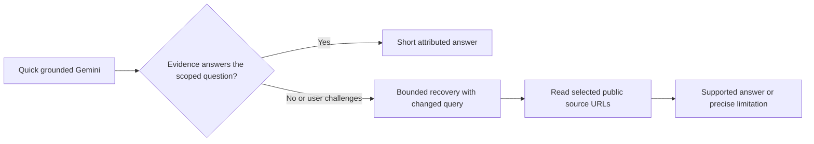

# Improve grounded Gemini's search recovery

Keep grounded Gemini as the primary backend. The strongest supported improvement is a bounded recovery path that changes the query, reads selected sources, and checks whether the evidence establishes the requested fact. Increasing search depth or changing models alone leaves several harness barriers intact. This is a proposed design, not an implemented or measured quality improvement. [Evidence and reproductions](evidence/WEB-SEARCH-CRITIQUE-2026-11-28.md).

## What do the examples establish?

The local November 26 Miss Universe transcript contains a spoken reply saying the winner was unavailable, followed by a request to check more broadly. That establishes an unsatisfactory answer; it does not establish that the answer was absent from Google's index.

November 16 KoolPals server traces report three different latest episodes: 1032, 1053, and 1056. The Spotify-specific turn admits it could not confirm anything newer than 1053, yet calls 1053 “the latest.” A retrieved candidate was promoted into an unsupported completeness claim. These traces concern this harness; the separate GPT-6.1-terra failure remains a user report.

## Which assumptions fail under scrutiny?

| Priority | Assumption under attack | Finding and consequence |
|---|---|---|
| P0 | A failed answer naturally tries the next backend. | A grounded non-answer returns as non-null text and terminates fallback. A mocked reproduction made two Gemini searches and two directness checks, with zero Tavily requests. |
| P0 | Asking the agent to search harder permits deeper retrieval. | The pipeline shares one lookup result across `web_answer`, `web_research`, and Wikipedia for the entire turn. Matching “who is” questions can also redirect research back to the quick tool. More elaborate prompts cannot reliably overcome these controls. |
| P1 | Search activity and source names establish support. | The parser retains a source list and first supporting source index, losing the full claim-to-source mapping. The directness judge sees the generated answer, not source passages. It checks whether the reply answers, rather than whether the evidence proves it. Its word-overlap safeguard accepts a reproduced negation inversion. |
| P1 | Rechecking means a fresh search. | Quick answers cache for ten minutes; research results for an hour. Longer platform-qualified queries can collide under fuzzy matching. A broad retry may reuse precisely the evidence the user challenged. |
| P1 | The research lane reads deeply. | Tavily research disables raw content and clips each snippet to 400 characters, 2,000 overall. In credit-saving modes it can instead return a Gemini summary without source URLs. This is shallow retrieval and a variable evidence contract. |
| P1 | More search time necessarily buys useful work. | Gemini gets three seconds per attempt and a nominal 4.5-second shared budget; retry wording chiefly demands specificity. The harness lacks an explicit evidence-gap recovery strategy. |

Preserve the existing anti-guessing rule, deduplication, credit controls, and latency-aware ordinary lookup. Change their scope so they permit deliberate recovery.

## How should grounded Gemini recover?

Use this proposed sequence:

1. **Fix the harness contract first.** Return a structured outcome: answered, insufficient evidence, conflicting evidence, timeout, or provider failure. Keep speech separate. Deduplicate by question, scope, and retrieval stage; allow recovery to bypass a challenged cache entry. Keep one total request/time allowance across quick and recovery work.
2. **Add Gemini-only recovery.** Resolve entity, platform, target period, and request time. On insufficient evidence, try a meaningfully different query: result announcement or winner rather than preview; official episode listing rather than generic podcast search. Preserve previous queries, candidates, and missing evidence. “Search first” is an instruction, not proof of execution.
3. **Read discovered sources.** Google documents Search plus URL Context, including URL Context support for Gemini 3.1 Flash-Lite. Trial it behind a flag and inspect retrieval status. Verify the exact model/API combination before integration: current documentation examples use a newer API than this repo. URL Context is not a logged-in browser and does not recursively follow links. [Google guidance](https://ai.google.dev/gemini-api/docs/url-context).
4. **Separate evidence collection from speaking.** Let recovery retain dated claims and source links before producing the two-sentence answer. Preserve all available support mappings. Test any structured-output/tool combination on the actual endpoint; a schema is a formatting constraint, not a truth check.

Start experimentally with at most two additional grounded calls and two selected URLs under a 15-second recovery deadline. Count judges and reading within that deadline; cap tokens and provider usage separately. Returned search-query metadata can undercount billed work, so the local query ledger is not a hard spending ceiling. [Google grounding documentation](https://ai.google.dev/gemini-api/docs/google-search). Acknowledge once, allow cancellation, and retain partial evidence. These are trial bounds. Explicit “check more broadly” requests should enter recovery. Longer work can reuse the research runner on the separate feature branch after its missing integration and cost controls are addressed.

## How should “latest” handle indexing limits?

Require a platform, event/edition, and as-of time internally. For podcasts, compare release dates within the requested platform and distinguish full episodes, trailers, clips, scheduled releases, and availability by market. A newer page publication date does not establish a newer episode.

Prefer the show's platform listing, a verified public feed, or an authenticated API when available. Spotify documents episode dates, pagination, and market filtering; access and show availability still need testing. [Spotify episode API](https://developer.spotify.com/documentation/web-api/reference/get-a-shows-episodes). One authoritative current listing may suffice; two syndicated stale articles do not.

For pageants, read a result-bearing source for the correct edition; challenge a stale official homepage with dated reporting. If coverage remains incomplete, say “The newest episode I could verify is X, dated Y; I couldn't confirm anything newer.” Never infer nonexistence from no search hits. Test Tavily or another provider only after Gemini recovery, to measure additional coverage; selected-page extraction is available through [Tavily Extract](https://docs.tavily.com/documentation/api-reference/endpoint/extract).

## What would prove the change helps?

Compare baseline, Gemini query repair, query repair plus URL reading, and optional provider fallback on the same timestamped cases. Start with both examples and decoys: pre-result pages, stale official pages, delayed indexing, different platform release dates, inaccessible listings, false premises, and user-requested rechecks.

Use archived evidence for deterministic checks and repeated live runs for coverage. Score supported correct answers, false “latest” claims, avoidable abstentions, actual fresh retrieval on recheck, latency to first useful fact/completion, and total usage. Existing keyword checks cannot establish these properties. Keep model choice and budgets fixed in retrieval comparisons; benchmark a stronger Gemini model separately. Proceed only with better answer recovery and no observed increase in unsupported claims on the held-out set; report counts and uncertainty.

## Open items

- `Evidence needed`: Obtain the November 27 Pi provider/turn traces and the terra trace before assigning either incident a definitive cause. The local Miss Universe recording is November 26 and lacks provider payloads.
- `Evidence needed`: Run an owner-approved live Gemini recovery subset. The offline reproductions establish harness defects, not how much URL reading will improve real answers.
